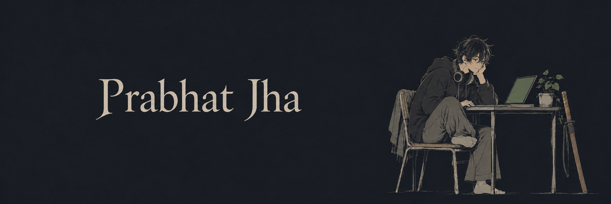

  

  <a href="https://prabhatjha.me">My corner of the internet</a> &nbsp; / &nbsp;
  <a href="https://www.linkedin.com/in/prabhat-jha-a0aa93337/">LinkedIn</a> &nbsp; / &nbsp;
  <a href="https://x.com/_08_prabhat">X</a> &nbsp; / &nbsp;
  <a href="mailto:jhaprabhat.anand@gmail.com">Say hi</a>

### Hey, I'm Prabhat.

**CSE '28 · Government College of Engineering, CSN, Maharashtra.**

Most of my curiosity goes into **AI/ML and backend engineering**, but I like following an idea wherever it leads: a web app, a developer tool, or a native Linux notepad.

I learn by building, getting stuck, and figuring out why something behaves the way it does. I'm interested in the whole journey from a model's output to a useful product: retrieval, APIs, databases, permissions, and the interface someone actually uses. There's plenty I'm still learning, and I like leaving room for experiments along the way.

**My magic is never give up.**

### The arc so far

- **Exploring AI:** from a small RAG pipeline to tools that show the evidence behind their answers.
- **Going deeper into backend:** interned at **dotBuild** (June–July 2026), working on APIs, auth, database architecture, and payment flows for a gym-management SaaS.
- **Taking side quests:** C++ problem-solving, codebase exploration tools, and a native Linux editor. Curiosity gets a vote.

### Tools I reach for

  

### A few things I've built

<table>
  <tr>
    <td width="50%" valign="top">
      <h3><a href="https://github.com/23-prabhat/Serpapi-hackathon">01 / Kabtak</a></h3>
      
Scholarship deadlines with source evidence. AI, with receipts.

      
<code>Python</code> <code>FastAPI</code> <code>Next.js</code>

      
<a href="https://www.youtube.com/watch?v=QK3M5dc2Ukk">Watch the demo ↗</a>

    </td>
    <td width="50%" valign="top">
      <h3><a href="https://github.com/23-prabhat/RepoMD">02 / RepoMD</a></h3>
      
Explore codebases through architecture diagrams and chat, on the web or in your terminal.

      
<code>TypeScript</code> <code>Next.js</code> <code>AI</code>

      
<a href="https://github.com/23-prabhat/Swayambhu_PS_04/blob/main/explanation.md">Explore the architecture ↗</a>

    </td>
  </tr>
  <tr>
    <td width="50%" valign="top">
      <h3><a href="https://github.com/23-prabhat/Velozity">03 / Velozity</a></h3>
      
A project desk with role-based access, task tracking, and real-time activity.

      
<code>React</code> <code>Express</code> <code>PostgreSQL</code>

      
<a href="https://github.com/23-prabhat/Velozity#authentication-and-authorization">Under the hood ↗</a>

    </td>
    <td width="50%" valign="top">
      <h3><a href="https://github.com/23-prabhat/Slate">04 / Folio Notepad</a></h3>
      
A native Linux notepad with Markdown, drawing, and draft recovery. Still in development.

      
<code>Python</code> <code>Qt</code> <code>SQLite</code>

      
<a href="https://github.com/23-prabhat/Slate#everyday-use">See what it does ↗</a>

    </td>
  </tr>
</table>

**Practice arc** · [LeetCode](https://leetcode.com/u/Jha_Prabhat/) · [Codeforces](https://codeforces.com/profile/_23_prabhat) · [CodeChef](https://www.codechef.com/users/prabhat_23)

---

Got an interesting side quest? [Let's build.](mailto:jhaprabhat.anand@gmail.com)
